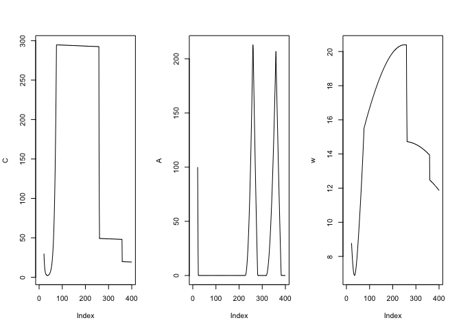

Simulations
================

``` r
set.seed(1)
T_len <- 400; K <- 100

a1 <- 0.4      
a2 <- 0.6      
alpha <- 0.3  
w0 <- 15
k <- 0.5
psi_max <- 0.8
nu <- 20
t0 <- nu + 1
w_min <- 5
W <- 200
gamma <- 0.2
tau <- 5
lambda <- 0.05
mu <- 0.1
dep <- 0.3 # capital depreciation
eps <- rnorm(1, mean = 0, sd = .02)
sigm <- 0.6
rn <- 0.3
K <- 100000
d_Nbase <- 0.1

N_test <- seq(40, by = 2, length.out = T_len)  
#C_test <- seq(30, by = 3, length.out = T_len)   

phi <- unique(c(0, 1, 2, 3)) # phase indicator
v <- unique(c(0, 1)) # latch
```

``` r
func_labor_supply <- function(w, w0, k, psi_max, N_lag) {
  share <- psi_max / ( 1 + exp(-k*(w - w0)) )
  share * N_lag
}

func_labor_demand <- function(alpha, theta, Z, C_prev, w) {
  ld1 <- (((1-alpha)*theta*Z*C_prev^alpha)/w)^(1/alpha)
  ld2 <- 1/(a1+theta*a2)
  ld1 * ld2
}

solver <- function(w, w0, k, psi_max, N_lag, nu, alpha, theta, Z, C_prev) {
  func_labor_demand(alpha, theta, Z, C_prev, w) - func_labor_supply(w, w0, k, psi_max, N_lag)
}
```

``` r
latch_exp <- function(N, v) {
  
  c0 <- unique(c(0, 1))
  for (t in (t0+1):T_len) {
    
    second_der1 <- (N[t-1]-N[t-2]) - (N[t-2]-N[t-3])
    second_der2 <- (N[t]-N[t-1]) - (N[t-1]-N[t-2])
    if (second_der1 > 0 || second_der2 > 0) {
      c0 <- 1
    }
    v[t] <- max(v[t-1], c0)
  }
}
```

``` r
N <- C <- A <- w <- w_sol <- R1 <- rep(NA, T_len)

# initial condition
N[1:t0] <- 40
C[t0] <- 30
A[t0] <- 100
R1[1:t0] <- 0

# exogenous path, should be filled before the loop
theta <- seq(1, 0.3, length.out = T_len)   # automation (declining)
Z <- seq(1, by = 0.2, length.out = T_len)      # time varying technology parameter (increasing)
```

``` r
for (t in (t0+1):T_len) {
  
  N_lag <- N_test[t-nu] # labor supply input
  N_prev <- N_test[t-1] # for population update
  C_prev <- C[t-1]
  A_prev <- A[t-1]
  theta_t <- theta[t]
  Z_t <- Z[t]
  
  w_sol[t] <- uniroot(solver, lower = w_min , upper = 1000, 
                      w0 = w0, k = k, psi_max = psi_max, N_lag = N_lag,
                      nu = nu, alpha = alpha, theta = theta_t, Z = Z_t, C_prev = C_prev)$root
  w[t] <- max(w_sol[t], w_min)
  
  Ld <- func_labor_demand(alpha, theta_t, Z_t, C_prev, w[t])
  Ls <- func_labor_supply(w[t], w0, k, psi_max, N_lag)
  R1[t] <- max(Ls-Ld, 0)
  
  Y <- Z_t*C_prev^(alpha)*Ld^(1-alpha) # output
  rho <- Y-w[t]*Ld # surplus
  
  period <- 25
  dep_t <- dep*1.05^(t/period)
  t_rho <- 0.2*0.6^(t/period)
  
  C[t] <- C_prev +.2*rho - dep*C_prev + eps
  if (C[t]>10*C[t0]) {
    C[t] <- C_prev + eps
  }
  
  A[t] <-  max(0, A_prev + mu*(rho/w[t]) + lambda*(R1[t-tau]) - gamma*W)
  if (A[t]>W) {
    C[t] <- C_prev + t_rho*rho - dep_t*C_prev + eps
  }
  
  #N[t] <- N_prev + rn*(N_prev/K) - dn*N_prev
  
}
```

``` r
summary(C) ; summary(w) ; summary(A)
```

    ##    Min. 1st Qu.  Median    Mean 3rd Qu.    Max.    NA's 
    ##   2.256  48.133 141.986 163.059 293.536 294.723      20

    ##    Min. 1st Qu.  Median    Mean 3rd Qu.    Max.    NA's 
    ##   6.884  13.992  14.721  15.617  19.110  20.393      21

    ##    Min. 1st Qu.  Median    Mean 3rd Qu.    Max.    NA's 
    ##    0.00    0.00    0.00   25.89   17.91  212.93      20

``` r
par(mfrow = c(1,3))
plot(C, type = "l")
plot(A, type = "l")
plot(w, type = "l")
```

<!-- -->

``` r
par(mfrow = c(1,1))
```
