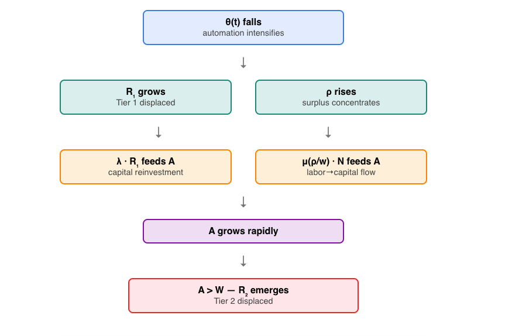

```{r setup, include=FALSE }
library(dplyr)
library(ggplot2)
library(tidyr)
library(sandwich)
library(lmtest)
library(patchwork)
library(MASS)
library(brms)
```


Walrasian Equilibrium :  $L^s(w)=L^d(w)=L$

The market clears when the quantity of labor demanded by the firm exactly equals to the quantity of labor supplied by the workers at a specific market-clearing wage $w$ .

-   $L^s(w)$ :  Labor supply function (The workers)

-   $L^d(w)$ : Labor demand function (The Firms)

Where : 

$$
\frac{\partial L^s}{\partial w} > 0 , \frac{\partial L^d}{\partial w} < 0
$$

- When wage decreases, companies want to hire more (downward-sloping) : $\frac{\partial L^d}{\partial w} < 0$

- When wage increases, workers want to work more (upward-sloping) : $\frac{\partial L^s}{\partial w} > 0$

The firm sets the labor demand so that $w = MPL$ , where $MPL$ is the **Marginal Product of Labor (MPL)** — the additional output produced by one more unit of labor. When wage equals $MPL$, the firm has no incentive to hire more or less.

Wage can be expressed as follow : 

$$w=\frac{U'_{leisure}}{U'_{consumption}}$$ 

-   $U'_{leisure}$ : Marginal Utility of Leisure

-   $U'_{consumption}$ : Marginal Utility of Consumption

This ratio is called **Marginal Rate of Substitution (MRS)**.

The market requires both conditions simultaneously : 

$$
w= MPL = \frac{U'_{leisure}}{U'_{consumption}}
$$

The workers and the firm optimize the wage by setting $w$ as $w = MRS$ and $w = MPL$ respectively. The market clears when $MRS = MPL$

- Workers optimize -> wage = MRS

- Firms optimize -> wage = MPL

- Market clears -> MRS = MPL

In a pure Walrasian World, the reserve army and the elite overproduction cannot mathematically exist, but in the actual economy, the markets do not clear instantly because of frictions — automation, position scarcity...

**Excess demand function** : The Walrasian tatonnement works through excess demand 

$$
ED(w) = L^d(w) - L^s(w)  
$$

- $ED>0$ : more demand than supply -> wage rises

- $ED<0$ : more supply than demand -> wage falls

- $ED = 0$ : market clears -> equilibrium

The frictions are the mechanisms that keep $ED \neq 0$ persistently.

#### Tier 1 : standard reserve army 

**Friction : Automation**

Automation causes labor displacement that forces job-to-job transitions, and since the skills of the displaced workers are considered obsolete, it will result to a relatively prolonged unemployment to acquire new skills for the existing positions . Thus, automation prevents the equilibrium of the Walrasian model. 

Automation is a capital-substitute for labor : firms choose to demand less labor because the machines can do the job. So automation affects the labor demand. 

By introducing this friction to the $MPL$ , the wage will be expressed with a time varying technology parameter $A(t)$ .

$MPL$ is a derivative of the following Production function (Cobb-Douglas) : 

$$
Y = A(t) \cdot K^{\alpha} \cdot L^{(1 - \alpha)}
$$

- $A$ : Time varying technology parameter

- $K$ : Capital

- $L$ : Labor

- $\alpha$ and $1 - \alpha$ : Distribution of the income between the capital and the Labor. Typically $\alpha = 0.3$ and $1-\alpha = 0.7$ 

For this project, the labor is splitted to automatable labor $L_a$ and non-automatable labor $L_n$. $L_a$ is composed by the workers who perform routine, codifiable tasks that machines can replace, while $L_n$ represents the workers who perform tasks that complement rather than compete automation — creativity, judgment, social interaction, complex problem solving. So the production function become : 

$$
Y = A(t) \cdot K^{\alpha} \cdot \tilde{L}^{(1 - \alpha)} 
$$

with $\tilde{L}$ = $L_n + \theta(t) \cdot L_a$ . $\theta(t)$ is an automation coefficient — how productive automatable workers are relative to machines. When $\theta(t)$ falls, automation intensifies. 

To determine $MPL$ , we take the derivative of $Y$ with respect to $L_a$ . Using the chain rule : 

$$MPL = \frac{\partial Y}{\partial L_a} = \frac{\partial Y}{\partial \tilde{L} } \cdot \frac{\partial \tilde{L}}{\partial L_a }$$

$$\frac{\partial Y}{\partial \tilde{L} } = (1- \alpha) A(t) \cdot K^{\alpha} \cdot \tilde{L}^{- \alpha}$$

$$\frac{\partial {\tilde{L}}}{\partial L_a } = \theta (t)$$

$$MPL = w = (1- \alpha)\cdot \theta(t)\cdot \frac {A(t) \cdot K^{\alpha}}{(L_n + \theta(t) \cdot L_a)^{\alpha}}$$

Automation reduces the demand of automatable labor $L^d_a$ . To get $L^d_a$ , we solve the equation above for $L_a$ as a function of the wage $w$ :

$$
L^d_a = \frac{1}{\theta(t)} [(\frac{(1-\alpha) \cdot \theta(t)\cdot A(t) \cdot K^{\alpha}}{w})^{1/\alpha} - L_n]
$$

-   **Verifying the slope condition** $\frac{\partial L^d_a}{\partial w} < 0$ 

$$
Y = (1-\alpha) \cdot \theta(t) \cdot A(t) \cdot K^{\alpha}
$$

$$
L^d_a = \frac{1}{\theta(t)} [\frac{Y}{w}]^{1/\alpha}
$$

$$
L^d_a = \frac{1}{\theta(t)} \cdot Y^{1/\alpha} \cdot w^{-1/\alpha}
$$

$$
\frac{\partial L^d_a}{\partial w} = \frac{-1}{\alpha} \cdot \frac{1}{\theta(t)} \cdot Y^{\frac{1}{\alpha}}  \cdot w^{\frac{-1-\alpha}{\alpha}} < 0
$$

-> $\frac{\partial L^d_a}{\partial w}$ is indeed negative. 

This Tier 1 friction is the excess labor supply, given as :

$$
R_1(t) = L^s_a(w) - L^d_a(w, \theta (t)) > 0
$$

- $R_1$ : reserve army of labor 

- $L^s_a(w)$ : automatable labor supply

- $L^d_a(w, \theta(t))$ : automatable labor demand

Walrasian model requires  $R_1(t)$ = 0, but when automation falls $\theta(t)$ faster than wage $w$, the excess labor supply persists. — The desired wage $w_1$ at which the workers are willing to work does not match the wage $w_2$ at which the firms are willing to hire . 

When automation arrives, a part of the works can be done by machines. Thus, $w_2$ is adjusted by the firms as technology improves. Generally, $w_2$ falls. But in real world, $w_1$ can not instantly falls to $w_2$, because of the workers existing contracts, the minimum wage floor, the workers may not refuse to accept lower wage. But most importantly, the wage can not fall below what is needed to survive — **The subsistence floor**  $\bar{w}$

-   **How** $\theta$ **affects the labor demand — Sign of** $\frac{\partial L^d_a}{\theta}$

$$
P = \frac{(1-\alpha) \cdot A(t) \cdot K^{\alpha}}{w}
$$

$$
L^d_a = \frac{1}{\theta(t)} \cdot P\cdot\theta(t)^{1/\alpha} - L_n
$$
$$
L^d_a  = \theta(t)^{\frac {1-\alpha}{\alpha}} \cdot P^{1/\alpha} - L_n
$$

$$
\frac{\partial L^d_a}{\partial \theta} = [(\frac {1-\alpha}{\alpha})\cdot P^{1/\alpha}\cdot \theta]^{1/\alpha} > 0
$$

-> $\frac{\partial L^d_a}{\partial \theta}$ is positive. When $\theta(t)$ falls, the labor demand $L^d_a$ falls. Intuitively, as automatable workers become less productive relative to machine ($\theta$ falls), firms want fewer of them at any given wage.

With the wage stickiness and the swift technological progess, $\theta(t)$ falls faster than the market-clearing wage $w$ . This yields to a decreasing labor demand and a persistent excess of labor supply.

-   **Equilibrium : MRS and MPL cross at wage** $w$ : 

The Marginal Rate of Substitution represents the workers'optimization. They choose how many hours to work by balancing the benefit of working — earning wage to buy consumption goods, the cost of working — giving up leisure time. Then, higher wage makes working more attractive than leisure. Workers have reservation wage : below this wage, leisure time is more valuable than consumption wage buys. But crucially, there is a subsistence constraint — consumption can not fall below some minimum $\bar{c}$ . 

Friction occurs when minimum wage workers are willing to accept is lower than what the firms accept to pay. The maximum wage the firms are willing to pay is the Marginal Product of Labor. If the maximum demand wage is below the minimum supply wage, no transaction is possible.

The friction condition is : $MPL(\theta(t), L_a)$ < $\bar{w}_{min}$ for all $L_a > 0$ 

The minimum wage expressed in terms of utility function and minimum consumption $\bar{c}$ : 

$$
\bar{w}_{min} = \frac{U'_{leisure}}{U'_{consumption} |_{c = \bar{c}}}
$$

At wage $\bar{w}_{min}$ , workers can purchase $\bar{c}$ goods. When the workers have more leisure time than working time, the consumption is very low. At a subsistence level, each additional unit of consumption is extremely valuable. Thus, $U'_{consumption}$ at $\bar{c}$  is a large denominator which makes $\bar{w}_{min}$ low.

**Under what condition on** $\theta(t)$ **does MPL and MRS curves can no longer intersect ?**

Given the friction condition $MPL(\theta(t), L_a)$ < $\bar{w_{min}}$ , we get : 

$$
(1- \alpha)\cdot \theta(t)\cdot \frac {A(t) \cdot K^{\alpha}}{(L_n + \theta(t) \cdot L_a)^{\alpha}} < \frac{U'_{leisure}}{U'_{consumption} |_{c = \bar{c}}}
$$

$$
\theta(t) < \frac{U'_{leisure}}{U'_{consumption} |_{c = \bar{c}}} \cdot \frac{(L_n + \theta(t) \cdot L_a)^{\alpha}}{(1- \alpha)\cdot A(t) \cdot K^{\alpha}}
$$

With : $Y = A(t) \cdot K^{\alpha} \cdot L^{(1- \alpha)}$ and $L = L_n + \theta(t) \cdot L_a$

$$
\theta(t) < \frac{U'_{leisure}}{U'_{consumption} |_{c = \bar{c}}} \cdot \frac{L^{\alpha}\cdot L^{1-\alpha}}{(1-\alpha)\cdot Y}
$$

$$
\theta(t) < \frac{U'_{leisure}}{U'_{consumption} |_{c = \bar{c}}} \cdot \frac{L}{(1-\alpha)\cdot Y}
$$

$$
\theta(t) < \frac{\bar{w}_{min}}{(1-\alpha)(Y/L)}
$$

-   $Y/L$  is the output per worker. 
-   $(1-\alpha)$ is the labor share.

The market breaks down when the automation coefficient $\theta(t)$ falls below the ratio of the minimum acceptable wage to the average product of labor scaled by the labor share. The labor demand curve has shifted so far left that it never intersects the labor supply curve above the subsistence floor, and the MPL and the MRS do not meet at the market clearing wage $w$ .The market clearing mechanism fails. 

When ${\bar{w}_{min}}$ rises, the subsistence costs increase as well. This yields to a rising threshold, making the breakdown more likely at any given $\theta(t)$ — The reserve army emerges sooner. When $Y/L$ increases, the threshold is delayed and the market stays stable longer. Higher productivity gives more room for firms to pay workers even if the automation coefficient $\theta(t)$ falls as technology is improving. 

We define the critical threshold: 

$$
\theta^*(t) = \frac{\bar{w}_{min}}{(1-\alpha)(Y/L)}
$$

This gives us a clean equation when $R_1$ activates : 


$$
R_1(t) = \begin{cases}
0 & \text{if } \theta(t)> \theta^\ast (t) \\
L^s_a(\bar{w}_{min}) - L^d_a(\bar{w}_{min},\theta(t)) & \text{if } \theta(t)< \theta^\ast (t)
\end{cases}
$$


#### Tier 2 : elite reserve army (elite overproduction)

In the formal mathematical models of Structural-Demographic Theory (SDT), the elites are represented through two variables framework : 

-   $E$ : the total number of elites

-   $A$ : the elite aspirants

The system has a restrained capacity, constrained by $W$ : the number of actual position available. $W$ is a fixed constant or grows very slowly $\Delta W \approx 0$ 

The elite growth is given by : 

$$
\frac{dE}{dt} = r_e \cdot E \cdot (\frac{\rho}{w})
$$

-   $r_e$ : the intrinsic growth rate of the elite class

-   $\rho$ : economic surplus generated by the economy

-   $w$ : average commoner wages

The expansion of the elite class is driven by an increase in the ratio $\frac{\rho}{w}$ . This ratio widens when $w$ stagnates or declines, or when $\rho$ grows. When both conditions occur simultaneously, they compound, resulting in a highly unequal society. 

According to Turchin and Nefedov (2009), "elite dynamics are governed not only by the biological reproductive rate but also by upward and downward social mobility." In an unequal economic environment, the economic surplus is concentrated among the wealthy middle class and the elites. The former can leverage this surplus to acquire elite credentials for themselves and their children — such as university degrees or political influence — facilitating their transition into the elite class. Conversely, established elites use their surplus to ensure their heirs remain within the upper tier, preventing downward mobility into the commoner population.  

**Friction : Positions scarcity**

Unlike Tier 1 where the failure is wage-based, Tier 2 failure is purely positional.
Structural elite positions (parliamentary seats, executive roles, ministerial posts, and top academic chairs) are finite, and established elites tend to block commoner access to them. Although symbolic gateways to the elite have democratized and multiplied, this expansion has outpaced the creation of actual elite positions. As a result, the elite class grows faster than the positions available to them. 

The positions growth is given by : 

$$
\frac{dW}{dt} = gw \cdot W
$$

with $gw$ as growth rate, and $gw \approx 0$ or very small. 

The elite growth rate is $r_e \cdot \frac{\rho}{w}$. The elite overproduction emerges when : 

$$
r_e \cdot \frac{\rho}{w} > gw 
$$

This is Tier 2 breakdown condition, analogue to $\theta(t) < \theta^{\ast}(t)$ from Tier 1. 

$r_e \cdot \frac{\rho}{w} > gw$ uses the total elite growth rate. Two possible scenarios can explain the growth of the elites : 

-   **scenario 1:** The elite growth is driven mainly by the established elites having more children. $E$ grows but most of the growth stay within the existing position holders — children replace parents. The aspirants grow slowly. 

-   **scenario 2:** The elite growth is driving by upward mobility from commoners and credentialed workers from Tier 1. The aspirants $A$ grows rapidly but the positions $W$ barely change.

-> The breakdown condition should ideally reference the aspirant component specifically. 

The aspirants growth is approximately the difference of the total elite growth and the established elite growth — which brings us back to the original breakdown condition, now with a clearer interpretation :  

$$
\frac{\dot{A}}{A} \approx \frac{\dot{E}}{E} - \frac{\dot{E_w}}{E_w} \approx r_e \cdot \frac{\rho}{w} - gw 
$$

When there are more elites than positions for them, the elite reserve army $R_2$ starts accumulating : 

$$
R_2(t) = max(A(t)-W(t),0)
$$

Elite overproduction occurs when $R_2 > 0$ , creating an elite reserve army of aspirants $A$ , who expect elite status. Historically, the rapid growth of this group is politically volatile. As Turchin notes, these "counter-elites" often spark revolutions by weaponizing the grievances of the standard reserve army for their own purposes.

Two distinct groups feed the aspirants pool : 

-   **wealthy commoners driven by opportunity :** surplus is available, credentials are affordable (upward mobility from commoners).

-   **workers driven by necessity :** automation has displaced them and facing a lack of alternative employment, credentials become a survival strategy  (cascade from Tier 1)

Thus, the aspirants growth is modeled by : 

$$
\frac{dA(t)}{d(t)} = [\mu \cdot (\frac{\rho}{w}) \cdot N] + [\lambda  \cdot R_1(t-\tau)] - \gamma \cdot W
$$

This is the cascade equation, which describes the flow of the reserve army from Tier 1 into Tier 2.

Term 1 — $\mu \cdot (\frac{\rho}{w}) \cdot N$: upward mobility from commoners.  

Term 2 — $\lambda \cdot R_1(t-\tau)$ : cascade from Tier 1. 

Term 3 — $\gamma \cdot W$ : placement into positions. 

-   $\mu \cdot (\frac{\rho}{w})$ : mobility rate from commoners to aspirants. 

-   $N$ : total commoner population.

-   $\lambda$ : fraction of Tier 1 seeking for an elite status.

-   $\tau$ : lag between the displacement and the credentials acquisition.

-   $\gamma$ : rate at which aspirants successfully fill positions.

**The Walrasian failure for positional goods**

The market clears perfectly when : $E=W$  — every elite aspirants hold a position. But in reality : $E>W$ and the excess is the aspirants pool $A$ .
In Tier 1, the Walrasian failure requires $\theta(t) < \theta^{\ast}$  — The automation coefficient falling below a threshold. But for Tier 2, there is no price mechanism that can adjust to clear the market. For positional goods, the relevant price is the status itself  — which is by definition relative and cannot adjust to clear the market. 

Formally, the general equilibrium would solve : 

$$
A(r) = W
$$

Where $r$ is the return to elite status — higher return yields to more aspirants. But $W$ is fixed, so the equation has no solution because the market is trying to solve an impossible problem : fitting an infinite number of aspirants into a finite and rigide number of elite spots. Consequently, market clearing is structurally impossible

-  $\theta(t)$ **as an unifying variable that links both tiers**

```{r dag, out.width="100%"}

```

This creates a double acceleration of elite overproduction. Both channels (upward mobility from commoners and cascade from Tier 1) are driven by the same underlying cause — a falling automation coefficient $\theta(t)$ .


